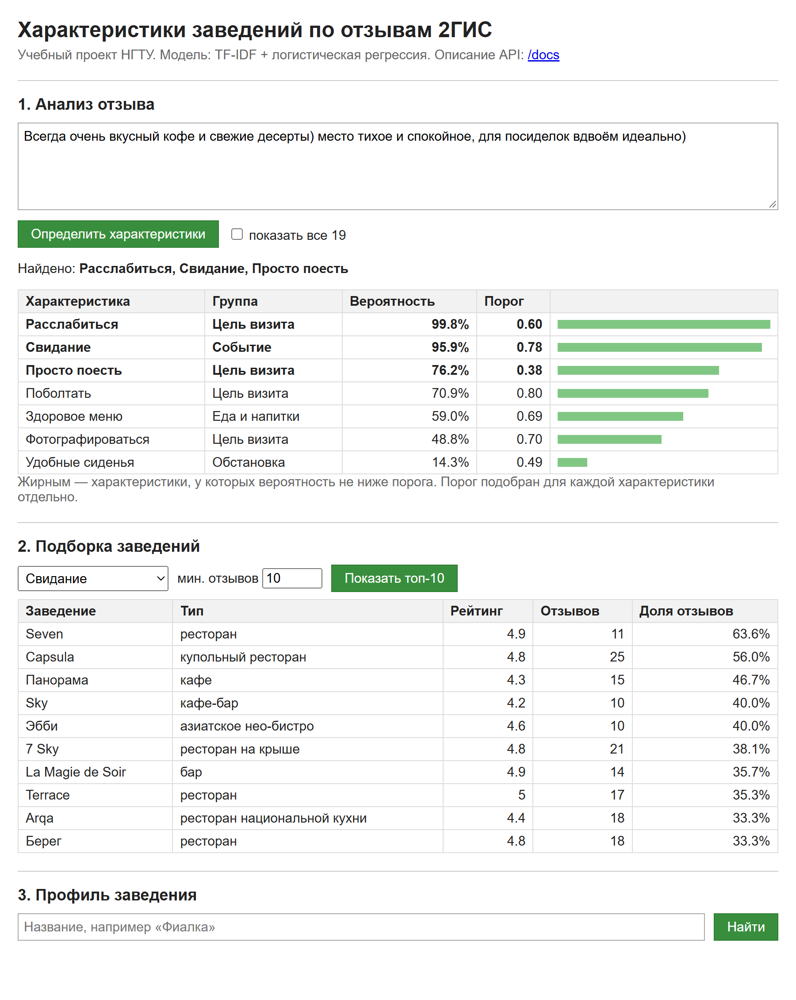

# Классификация отзывов 2ГИС по характеристикам заведений

Командный учебный проект НГТУ по кейсу 2ГИС. По тексту отзыва нужно определить,
какие субъективные характеристики подходят заведению: "Свидание", "Поработать",
"Красивый вид", "Покормить детей" и т.д., всего 19 меток. У одного отзыва может
быть несколько меток сразу (многометочная классификация).

## Команда

- Смолиенко А. А. - подготовка данных
- Душанов Т. Т. - модели: TF-IDF, Word2Vec, ruBERT (ноутбук `2Gis_V2.ipynb`)
- Димов К. А. - оценка качества, веб-сервис (`backend/`), презентация

Руководитель: Альсова О. К.

## Что в репозитории

- `2Gis_V2.ipynb` - обучение и сравнение моделей (Google Colab, GPU Tesla T4)
- `backend/` - веб-сервис на FastAPI: характеристики по тексту отзыва, профили
  заведений, подборки ТОП-10
- `Презентация_2ГИС_итог.pptx` - презентация проекта

## Результаты

Тестовая выборка - 25 057 отзывов.

| Модель | macro-F1 | PR-AUC |
|---|---|---|
| Логистическая регрессия на Word2Vec | 0.31 | 0.36 |
| Логистическая регрессия на TF-IDF (биграммы, свой порог для каждой метки) | 0.53 | 0.51 |
| ruBERT, дообучение | 0.55 | 0.59 |

Хуже всего распознаются редкие метки ("Добавить мистики", "День рождения") и
размытая "Необычные вкусы". Подробнее - в презентации и в `backend/reports/`.

## Данные

Датасет 2ГИС в репозиторий не входит (большие файлы, данные партнёра).
Для запуска нужно положить в папку `dataset/` файлы `task_2_vibes.json`,
`reviews.csv`, `reviews_clean.csv`, `train.csv`, `test.csv`.

## Веб-сервис

```bash
cd backend
python -m venv .venv
.venv\Scripts\activate
pip install -r requirements.txt
python scripts/train_tfidf.py
python scripts/build_venues.py
uvicorn app.main:app --port 8000
```

После запуска: демо-страница http://localhost:8000, документация API
http://localhost:8000/docs. Подробнее - в [backend/README.md](backend/README.md).


