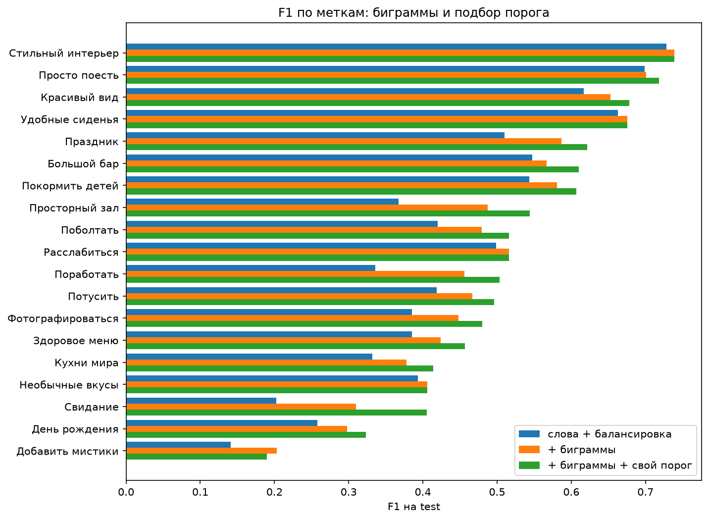
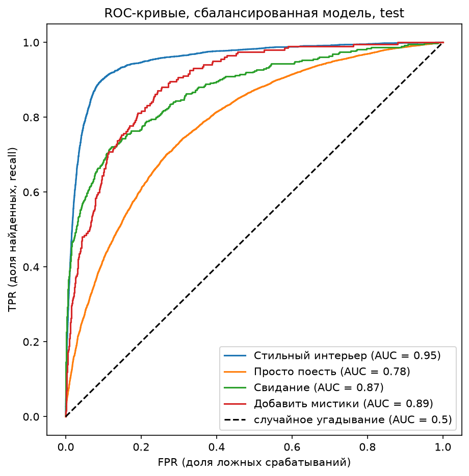
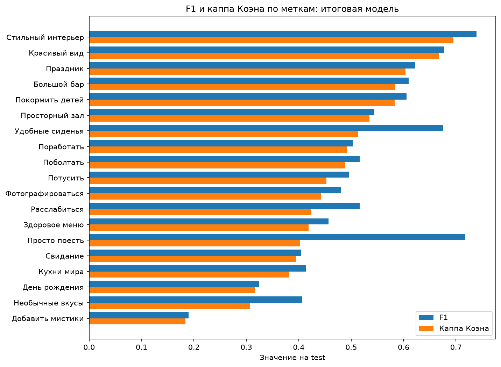
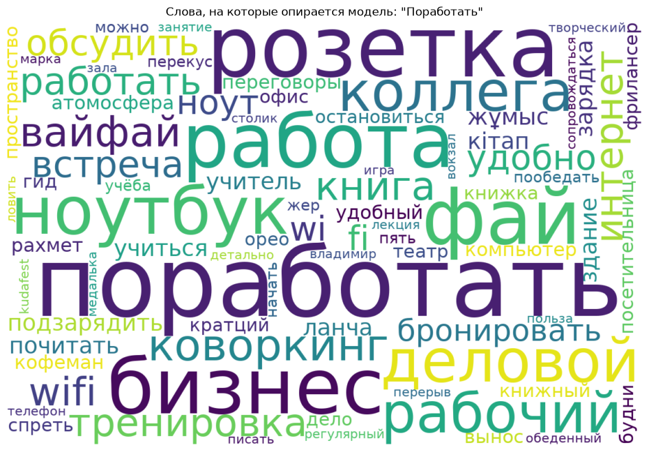
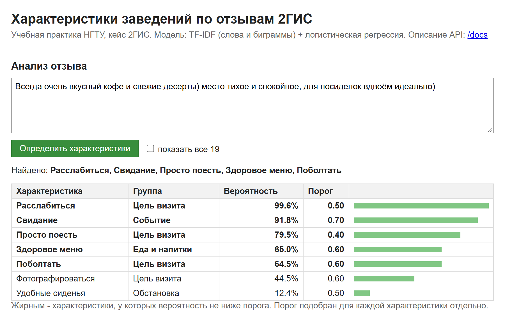

# Классификация отзывов по характеристикам заведений общественного питания

Учебная (ознакомительная) практика, АВТФ НГТУ, кейс индустриального партнёра 2ГИС.

По тексту отзыва нужно определить, какие субъективные характеристики подходят
заведению: "Свидание", "Поработать", "Красивый вид", "Покормить детей" и т.д.,
всего 19 меток. У одного отзыва может быть несколько меток сразу, поэтому это
многометочная классификация текстов (обучение с учителем): решается 19 задач
"да/нет", метка k ставится, если вероятность p_k(x) не ниже порога t_k.

## Команда

| Участник | Роль |
|---|---|
| Смолиенко А. А. | дата-инженер: загрузка и очистка данных, предобработка и векторизация текста |
| Душанов Т. Т. | ML-инженер: модели классификации, сравнение классификаторов |
| Димов К. А. | оценка точности моделей, визуализация и оформление результатов |

Руководитель: Альсова О. К., к.т.н., доцент.

## Структура

```
pipeline/            16 скриптов, запускаются по порядку
  common.py          общие настройки: пути, метки, предобработка текста
  01_load_json.py        1. Подготовка: загрузка JSON и таблица меток
  02_statistics.py          статистика и графики
  03_remove_duplicates.py   удаление повторов
  04_preprocess.py          стоп-слова, лемматизация (pymorphy3)
  05_split.py               разбиение 80/20
  06_tfidf_words.py      2. Векторизация: TF-IDF по словам
  07_tfidf_bigrams.py       TF-IDF по биграммам
  08_word2vec.py            Word2Vec
  09_logreg.py           3. Классификация: логистическая регрессия
  10_svm.py                 линейный SVM
  11_naive_bayes.py         наивный Байес
  12_thresholds.py          подбор порога для каждого класса
  13_metrics.py          4. Оценка и анализ: P, R, F1 по классам и macro, ROC
  14_kappa.py               каппа Коэна
  15_confusion.py           матрицы ошибок
  16_words.py               весомые слова, облако слов
results/             таблицы с метриками и графики (результат скриптов)
backend/             веб-сервис на FastAPI поверх итоговой модели
2Gis_V2.ipynb        эксперименты в Google Colab
```

Поток данных: JSON -> таблица отзывов -> очищенная таблица -> обучающая
и тестовая выборки -> признаки -> модели -> метрики и графики. Промежуточные
файлы пишутся в `data/`, модели - в `models/` (в репозиторий не входят).

## Результаты

Данные: 125 463 отзыва о 16 709 заведениях, 19 меток в 4 группах. После
удаления 177 повторов - 125 286 отзывов, разбиение 80/20: 100 229 / 25 057.
Все метрики - на тестовой выборке, macro - среднее по 19 меткам.

Улучшение базового решения (`results/steps.csv`):

| Шаг | Что изменили | macro-F1 |
|---|---|---|
| 1 | TF-IDF + логистическая регрессия, порог 0,5 | 0,35 |
| 2 | Лемматизация и удаление стоп-слов | 0,39 |
| 3 | Балансировка классов (веса) | 0,44 |
| 4 | Биграммы + свой порог для каждой метки | 0,52 |

Сравнение методов (`results/comparison.csv`), K - каппа Коэна:

| Модель | Признаки | P | R | macro-F1 | macro-K |
|---|---|---|---|---|---|
| Наивный Байес | TF-IDF | 0,46 | 0,08 | 0,11 | 0,08 |
| Лог. регрессия, balanced | Word2Vec | 0,22 | 0,77 | 0,31 | 0,24 |
| Лог. регрессия | TF-IDF | 0,73 | 0,29 | 0,39 | 0,35 |
| Линейный SVM, balanced | TF-IDF | 0,35 | 0,63 | 0,44 | 0,38 |
| Лог. регрессия, balanced | TF-IDF | 0,34 | 0,73 | 0,44 | 0,38 |
| Линейный SVM | TF-IDF | 0,67 | 0,34 | 0,44 | 0,40 |
| **Лог. регрессия, balanced + пороги** | **TF-IDF + биграммы** | **0,45** | **0,64** | **0,52** | **0,47** |

ROC AUC сбалансированной модели (TF-IDF по словам): в среднем 0,90, по меткам
от 0,78 до 0,98. Хуже всего распознаются редкие метки "Добавить мистики" и
"День рождения" (меньше 1% отзывов), лучше всего - "Стильный интерьер" и
"Красивый вид". У 67 из 107 повторяющихся текстов разметка различается -
характеристики субъективны.

Графики лежат в `results/figures/`:

| | |
|---|---|
|  |  |
|  |  |

## Как запустить

Датасет 2ГИС в репозиторий не входит (большой файл, данные партнёра).
Нужно положить `task_2_vibes.json` в папку `dataset/`.

```bash
python -m venv .venv
.venv\Scripts\activate
pip install -r requirements.txt
```

Скрипты запускаются по порядку из корня проекта, все вместе занимают около 10 минут:

```bash
for f in pipeline/[0-9]*.py; do python "$f" || break; done
```

В PowerShell:

```powershell
Get-ChildItem pipeline\[0-9]*.py | ForEach-Object { python $_.FullName; if (-not $?) { break } }
```

Веб-сервис (после скриптов):

```bash
cd backend
uvicorn app.main:app --port 8000
```

Подробнее - в [backend/README.md](backend/README.md).


